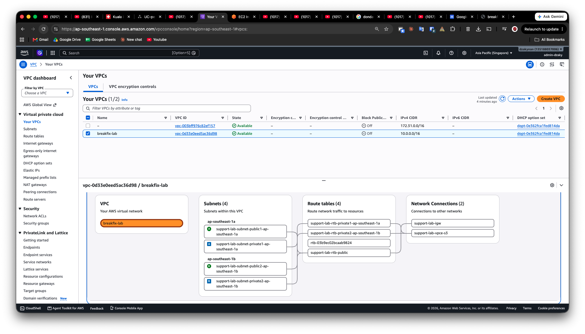
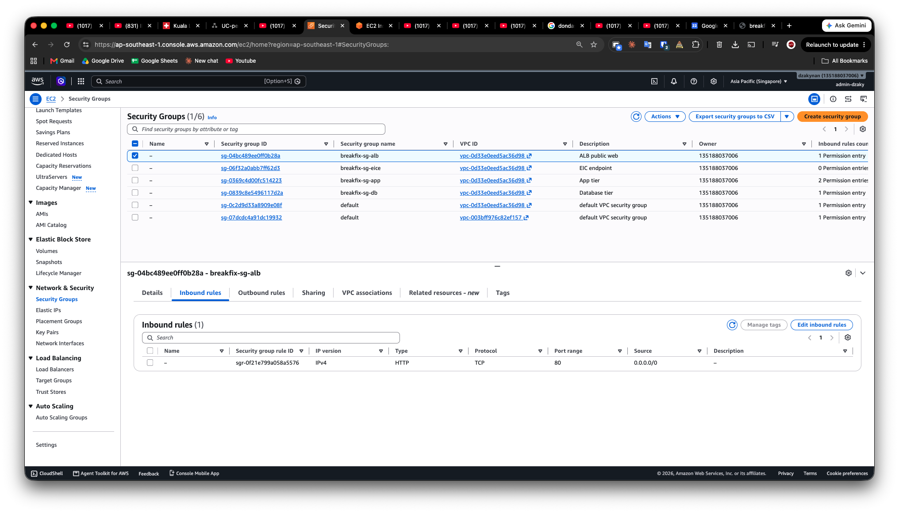
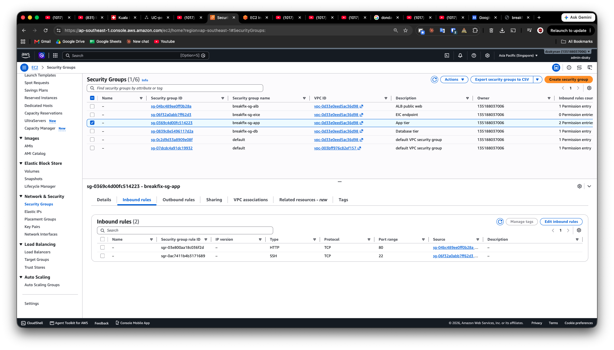
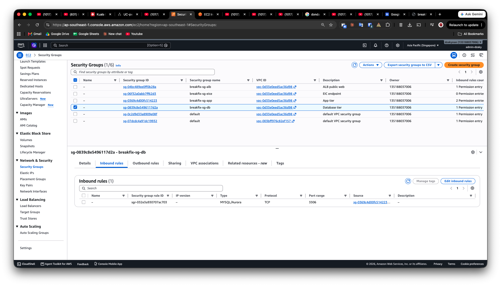
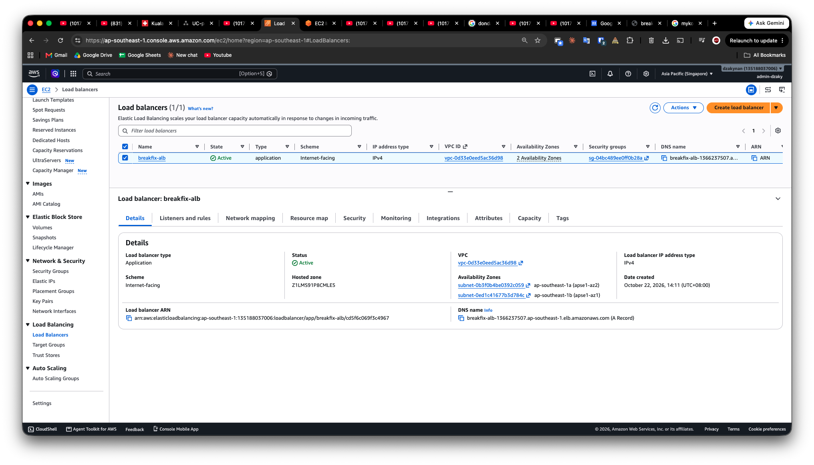
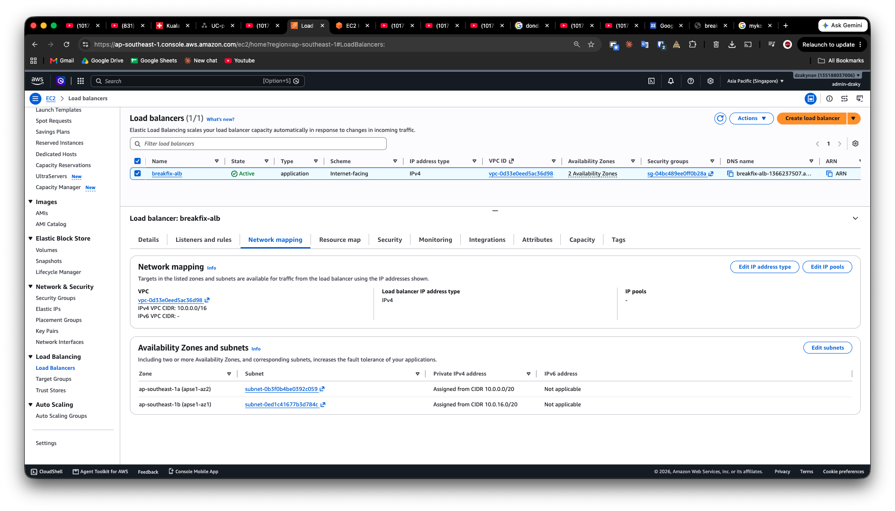
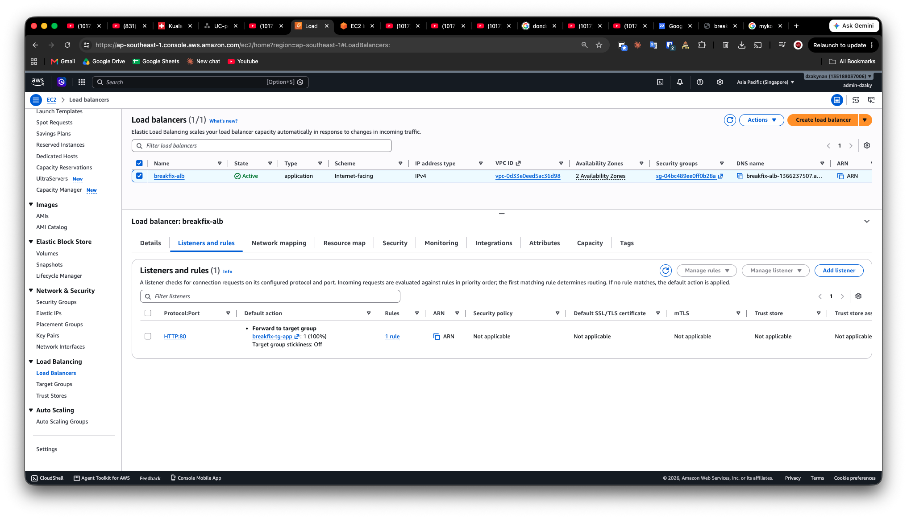
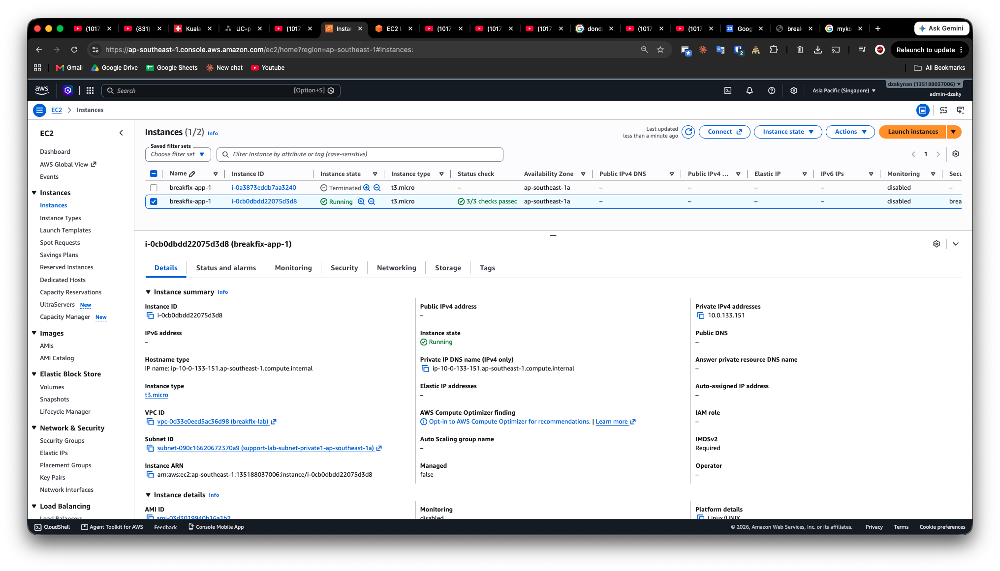

# AWS 3-Tier Break-and-Fix Lab

A hands-on AWS lab to practice cloud support skills. I built a small 3-tier network, tested it, and I am now breaking it on purpose and writing support-style tickets.

**Status:** Web and app tiers are built and tested. The database tier is only a security group (no database deployed yet). Break-and-fix tickets are in progress.

## Architecture

Internet -> Application Load Balancer (public subnets, 2 AZs) -> EC2 with nginx (private subnet) -> database tier (security group only)

## What I built

| Component | Details |
|---|---|
| Region | ap-southeast-1 (Singapore) |
| VPC | `breakfix-lab`, 10.0.0.0/16, 2 Availability Zones |
| Subnets | 2 public + 2 private |
| Internet access | Internet Gateway for public subnets. No NAT Gateway (cost). |
| S3 endpoint | Gateway endpoint (free). The private instance uses it to install packages. |
| Admin access | EC2 Instance Connect Endpoint. No public IP, no bastion, no SSH key. |
| App server | EC2 t3.micro, Amazon Linux 2023, nginx installed by user data, private subnet, no public IP |
| Load balancer | Internet-facing ALB, HTTP:80 forwarded to a target group |

## Security groups (security group to security group rules)

| Security group | Inbound |
|---|---|
| `breakfix-sg-alb` | HTTP 80 from 0.0.0.0/0 |
| `breakfix-sg-app` | HTTP 80 from `breakfix-sg-alb`; SSH 22 from `breakfix-sg-eice` |
| `breakfix-sg-db` | MySQL 3306 from `breakfix-sg-app` |
| `breakfix-sg-eice` | none |

Outbound rules are the AWS default (allow all). This is acceptable for a lab and can be tightened.

## How I verified it

- Target group shows the instance as **Healthy**
- `curl localhost` on the private instance (through the EC2 Instance Connect Endpoint) returned the nginx page
- The page opened in a browser through the ALB DNS name

## Screenshots

![E
