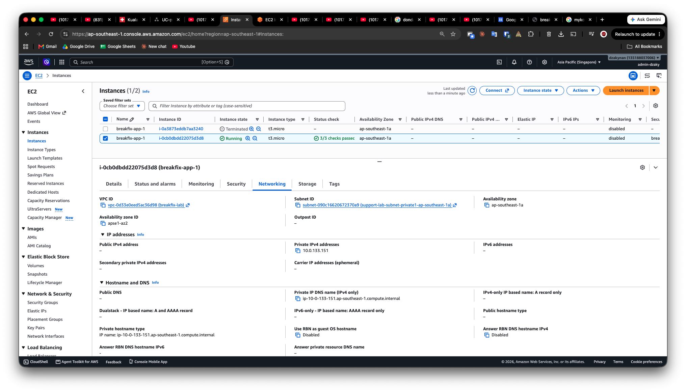
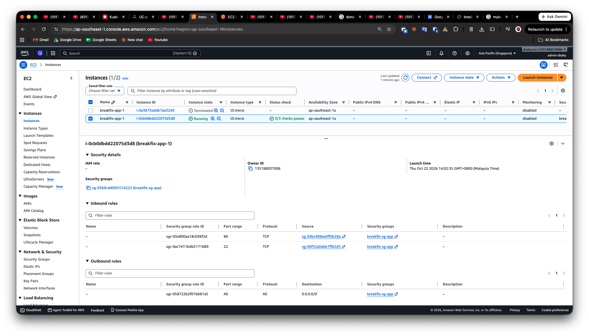
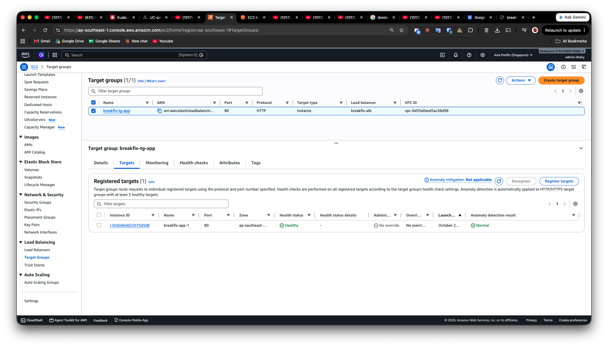

{\rtf1\ansi\ansicpg1252\cocoartf2870
\cocoatextscaling0\cocoaplatform0{\fonttbl\f0\fswiss\fcharset0 Helvetica;}
{\colortbl;\red255\green255\blue255;}
{\*\expandedcolortbl;;}
\paperw11900\paperh16840\margl1440\margr1440\vieww11520\viewh8400\viewkind0
\pard\tx720\tx1440\tx2160\tx2880\tx3600\tx4320\tx5040\tx5760\tx6480\tx7200\tx7920\tx8640\pardirnatural\partightenfactor0

\f0\fs24 \cf0 # AWS 3-Tier Break-and-Fix Lab\
\
A hands-on AWS lab to practice cloud support skills. I built a small 3-tier network, tested it, and I am now breaking it on purpose and writing support-style tickets.\
\
**Status:** Web and app tiers are built and tested. The database tier is only a security group (no database deployed yet). Break-and-fix tickets are in progress.\
\
## Architecture\
\
Internet -> Application Load Balancer (public subnets, 2 AZs) -> EC2 with nginx (private subnet) -> database tier (security group only)\
\
## What I built\
\
| Component | Details |\
|---|---|\
| Region | ap-southeast-1 (Singapore) |\
| VPC | `breakfix-lab`, 10.0.0.0/16, 2 Availability Zones |\
| Subnets | 2 public + 2 private |\
| Internet access | Internet Gateway for public subnets. No NAT Gateway (cost). |\
| S3 endpoint | Gateway endpoint (free). The private instance uses it to install packages. |\
| Admin access | EC2 Instance Connect Endpoint. No public IP, no bastion, no SSH key. |\
| App server | EC2 t3.micro, Amazon Linux 2023, nginx installed by user data, private subnet, no public IP |\
| Load balancer | Internet-facing ALB, HTTP:80 forwarded to a target group |\
\
## Security groups (security group to security group rules)\
\
| Security group | Inbound |\
|---|---|\
| `breakfix-sg-alb` | HTTP 80 from 0.0.0.0/0 |\
| `breakfix-sg-app` | HTTP 80 from `breakfix-sg-alb`; SSH 22 from `breakfix-sg-eice` |\
| `breakfix-sg-db` | MySQL 3306 from `breakfix-sg-app` |\
| `breakfix-sg-eice` | none |\
\
Outbound rules are the AWS default (allow all). This is acceptable for a lab and can be tightened.\
\
## How I verified it\
\
- Target group shows the instance as **Healthy**\
- `curl localhost` on the private instance (through the EC2 Instance Connect Endpoint) returned the nginx page\
- The page opened in a browser through the ALB DNS name\
\
## Screenshots\
\
\
\
\
\
\
\
\
\
\
\
\
\
\
\
## Lessons learned (real mistakes)\
\
1. **EC2 launched in the wrong subnet.** I first launched the instance in `public1` instead of `private1`. nginx did not respond. The probable cause is that the public route table has no S3 endpoint route and the instance has no public IP, so package install failed (I did not confirm this from logs). I found the mistake by checking the instance Subnet ID and private IP, then relaunched in `private1`.\
2. **NAT Gateway left running.** I created a NAT Gateway and forgot it for about a week. I found it in the Billing console, deleted it, and released its Elastic IP.\
3. **Forgotten resources from an earlier tutorial.** While auditing Billing I found two Aurora PostgreSQL clusters. I deleted them, plus their final snapshots and retained backups.\
4. **Billing access for IAM users is off by default.** The root user must enable "IAM user and role access to Billing information".\
\
## Break-and-fix tickets\
\
Each ticket follows: Symptom, Diagnosis, Root cause, Fix, Prevention. See the `tickets/` folder.\
\
| # | Scenario | Status |\
|---|---|---|\
| 1 | ALB target becomes Unhealthy after the HTTP rule is removed from `breakfix-sg-app` | Planned |\
| 2 | Private instance cannot reach the internet (blackhole route to a deleted NAT Gateway) | Planned |\
\
## Cost control\
\
After each session I delete the ALB and stop the EC2 instance. The EC2 Instance Connect Endpoint and the S3 gateway endpoint have no hourly cost.}